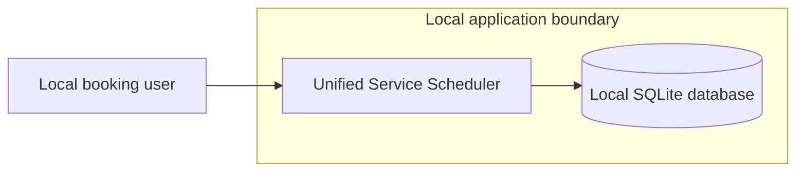
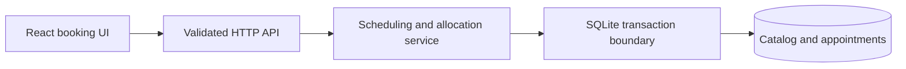
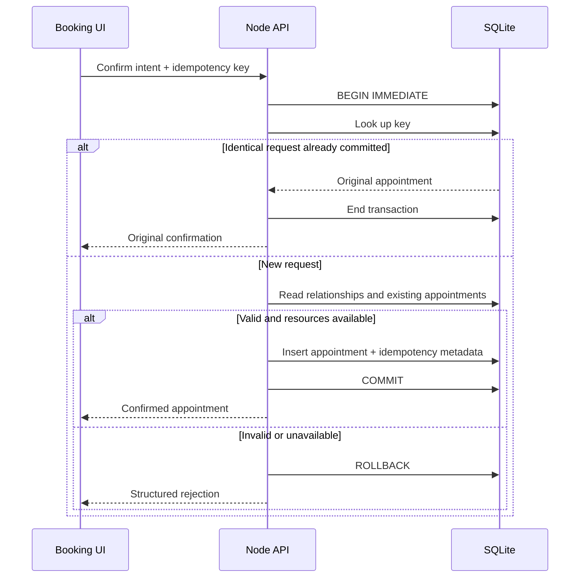
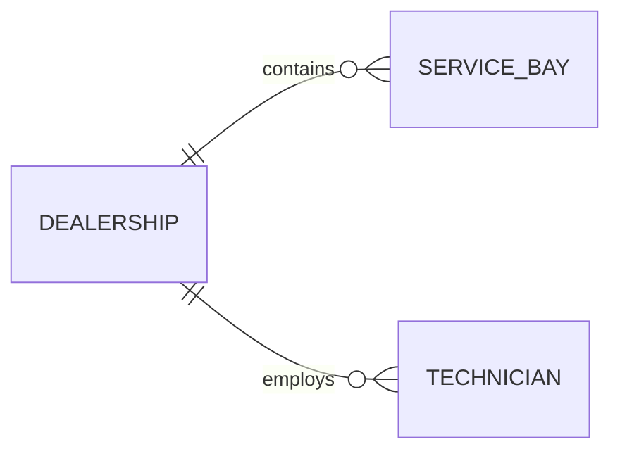
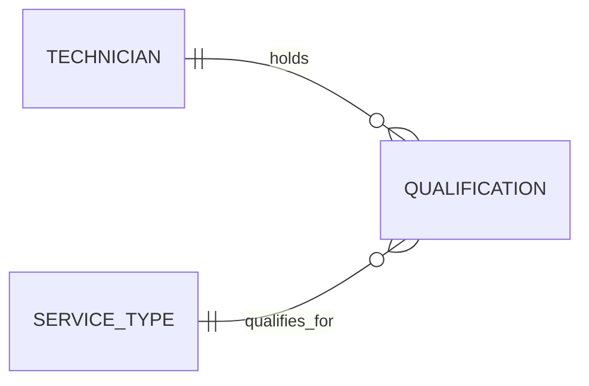

# Unified Service Scheduler: System Design

**Status:** Implemented local application. The booking guarantees and recording flow are exercised by the automated checks documented in [README.md](README.md#verification).

## 1. Overview

A local appointment scheduler replaces manual booking with one authoritative decision: a customer's vehicle can be booked only when a service bay and a qualified technician at the chosen dealership are available for the entire service.

The application uses React + TypeScript, a Node API, and SQLite. The design prioritizes explicit invariants, atomic allocation, retry safety, and testable failure behavior over additional infrastructure.

The source requirements are in [Scenario-A.md](Scenario-A.md).

Setup and verification instructions are in [README.md](README.md).

## 2. Requirements

### 2.1 Requirements stated by the scenario

The three requirements in [Scenario-A.md](Scenario-A.md) are:

1. Allow a user to request a service appointment for a specific vehicle, service type, dealership, and desired time.
2. Before confirming, check that both a service bay and a qualified technician are available for the entire service duration.
3. On success, persist an appointment associating the customer, vehicle, technician, and service bay.

The scenario does not prescribe vehicle registration, a customer-vehicle ownership rule, working calendars, timezones, authentication, or a particular UI. The following choices make those details concrete for this implementation; they are not additional requirements quoted from the scenario.

### 2.2 Scope assumptions and implementation choices

| Area | Adopted assumption or boundary |
|---|---|
| Existing records | Customer and vehicle records already exist. The demo seeds them rather than providing registration or import workflows. |
| Customer-vehicle association | Each vehicle is linked to one customer, and booking requests must use a vehicle linked to the selected customer record. This is a predefined association, not verification of legal ownership or authority to act for somebody else. |
| Service catalog and duration | Every dealership uses the same global service catalog. Each service has a configured duration, rather than a duration supplied by the browser or calculated separately for each vehicle. |
| Working calendar | All dealerships and technicians share one fixed weekday calendar, with a break between technician working periods. A service must fit entirely within one working period. Individual schedules, holidays, and overnight exceptions are excluded. |
| Resource assignment | The system automatically assigns one qualified technician and one bay for the whole appointment. Bays within a dealership are interchangeable; specialized equipment or bay capabilities are not modeled. Technician qualifications still vary by individual. |
| Time interpretation | A requested local time is interpreted in the dealership's IANA timezone, not the browser's timezone. Appointment instants are stored in UTC; ambiguous or nonexistent local times are rejected. |
| Occupancy rules | Vehicle overlaps are rejected in addition to technician and bay overlaps. Exact back-to-back appointments are allowed; no extra preparation or cleanup buffer is added. |
| Reservation timing | Displayed availability and time selection are advisory, not temporary holds. Confirmation rechecks availability and persists the booking atomically. |
| Delivery and identity | This is a local, single-instance application with a backend API and browser client. Demo-profile selection supplies customer context but is not authentication; all profiles and data are fictional. |
| UI scope | The browser shows seven days at a time with 15-minute start-time choices and lists persisted confirmations. This presentation is an implementation choice; the scenario only asks for a desired appointment time. |

### 2.3 Non-functional goals for this implementation

- Target a local single-instance application with a file-backed database.
- Booking correctness takes precedence over accepting conflicting requests.
- Confirmation and retry behavior must remain consistent under contention and uncertain network outcomes.
- Keep deployment and setup small; external services are unnecessary.
- Provide responsive, keyboard-accessible UI and explicit failures.
- No numerical availability or throughput SLO has been specified. Production capacity requires measurement.

### 2.4 Constraints and out of scope

This is a new application with no inherited framework.

- Identity and customer management: authentication, account provisioning, customer/vehicle registration, and legal-ownership verification.
- Additional booking workflows: payments, notifications, cancellation/rescheduling, and administrative screens.
- Operating variations and deployment: per-dealership service menus or hours, individual technician rotas, specialized bay capabilities, holiday/overnight exceptions, and cloud or multi-instance deployment.

## 3. System context

The browser, API, and database run locally. There are no external service integrations.

## 4. Technology stack

| Layer | Decision | Alternatives and trade-offs |
|---|---|---|
| Frontend | React, TypeScript, Vite | Server-rendered forms would use less client code but offer less convenient interactive preview state. Next.js adds server conventions not needed alongside this small API. |
| Backend | Node, TypeScript, Express | ASP.NET Core is equally capable, but one language across client and server simplifies this new application. A separate service per entity adds deployment and transaction complexity without a requirement. |
| Validation | Shared Zod schemas and domain checks | Static types alone do not validate HTTP input. Duplicated client/server definitions drift. Database constraints complement rather than replace API validation. |
| Demo identity | Entry-screen chooser and tab-scoped session storage | Password sign-in and credential setup add unnecessary work to this demonstration. This is explicitly not authentication and is unsuitable for real customer data. |
| Database | File-backed SQLite | PostgreSQL offers stronger multi-instance options and database exclusion constraints but adds a server to the local setup. In-memory or browser storage does not meet authoritative persistent allocation requirements. |
| Time | IANA dealership timezones, UTC appointment instants, timezone-aware library | Browser-local time silently changes meaning across users. Hand-written timezone conversion is error-prone around daylight-saving transitions. |
| Tests | Vitest plus Playwright | Unit-only testing cannot demonstrate database concurrency or user-visible behavior. Browser-only testing obscures precise transactional edge cases. |
| Operation | Loopback API, local file database, structured logs | Cloud hosting, managed telemetry, and containers are possible future deployment choices, not prerequisites for the challenge. |

Package versions are locked in `package-lock.json`. The application uses `better-sqlite3` with explicit transaction control and the Temporal polyfill for timezone conversion. The local build and tests use Node 24 on Windows.

## 5. High-level design

Use one application, with modules separated by responsibility rather than network boundaries. Shared scheduling predicates serve preview and confirmation; confirmation alone mutates appointments and re-evaluates against the transaction's database state. Fixed hours come from `SERVICE_SCHEDULE` in `src/server/config/workingHours.ts`, not from database records.

| Component | Responsibility |
|---|---|
| Booking UI | Collect booking intent, display advisory availability, handle confirmation and recoverable conflicts. |
| API | Validate request shape, expose catalog and appointments, map domain outcomes to structured responses. |
| Scheduling service | Resolve times, apply the shared working calendar, enforce ownership and overlap rules, and select a qualified technician and bay deterministically. |
| Persistence layer | Apply migrations, read catalog and appointment records, acquire the write transaction, and persist the appointment atomically. |

The client never chooses authoritative resource assignments or supplies an authoritative service duration.

## 6. Key use case flows

### 6.1 Preview

After profile selection, load that customer's vehicles and appointments. Select a vehicle and service, and submit a desired local start. The API validates the client-selected `X-Demo-Customer` header and rejects a conflicting customerId in the request body. Resolve the time in the dealership timezone, check the complete interval against opening hours, qualified shifts, existing bookings, and vehicle conflicts, then return an advisory result with a stable reason code.

The UI obtains those choices through `POST /api/availability/slots`. Each request returns exactly seven days, defaulting to today in the dealership timezone. `Scheduler.getAvailabilityWindow` generates quarter-hour starts within opening intervals and evaluates them with the same resource-finding rules used for confirmation, in one read transaction. Closed days and unavailable starts carry explicit state/reasons; malformed selections and invalid schedules fail explicitly.

The browser displays a seven-day date strip and morning/afternoon time buttons for the selected day. Previous/Next page by seven days. Only available times are selectable; a disclosure explains the unavailable ones. The 15-minute spacing is presentation granularity, not service duration or a new restriction on the existing minute-precision API.

Changing any booking input invalidates the previous preview. Ignore obsolete in-flight responses so an old result cannot appear to validate new inputs.

No time is preselected. Changing the day, week, vehicle, service, or dealership clears the selection. Confirmation conflicts retain their error while refreshing the slot window. The original idempotent request is preserved instead when a response is uncertain.

### 6.2 Confirm

The browser submits the booking intent with an idempotency key. The validated demo-profile header supplies the customer context.

The route calls `Scheduler.confirmAppointment`. For a new request, that method calls the read-only `findAvailableResources`, which first uses `resolveBookingContext` to validate and load the referenced records. Only confirmation persists the appointment. Naming and contributor conventions are documented in [AGENTS.md](AGENTS.md).

The confirmation flow is:

1. Validate request syntax and normalize the semantic request fields.
2. Acquire `BEGIN IMMEDIATE` before authoritative database reads.
3. Check for an existing successful request with the same key. Return its appointment for an identical request; reject a different request using that key.
4. Validate customer/vehicle ownership, dealership and service existence, desired time, opening hours, qualifications, working periods, and resource/vehicle conflicts.
5. Assign an available technician and bay, then insert the appointment with its idempotency metadata.
6. Commit before reporting success. Roll back on failure.

No network calls or asynchronous work occur inside the write transaction.

A preview can become stale. If another request wins first, confirmation returns a conflict and the UI refreshes availability. Availability-related failures also open a labeled in-app dialog explaining the resource issue, the affected appointment, and that no appointment was created. Dismissing it returns focus to the time picker. Unknown network outcomes and idempotency-key conflicts keep their distinct recovery behavior. The system never reports success merely because an earlier preview was available, and selecting a time does not create a hold.

### 6.3 Retry and reload

If the response is lost, the browser retries the unchanged request with the same key. The API returns the original appointment. Reusing that key with different request fields fails explicitly. Check successful replay before time-dependent validation so a previously confirmed appointment remains replayable after its start time.

The UI retains the key across uncertain network results under a profile-specific storage key and creates a new key when the booking intent changes. Switching profiles does not erase another profile's pending request. Returning to the original profile restores it; a different profile cannot reuse its key for another booking. This is workflow consistency, not authentication. Profile selections remain independent across tabs and survive reload and server restart while the tab session remains.

## 7. Data model

The model is shown in three focused views rather than one diagram with every connection. Repeated entity names refer to the same records, not separate copies. In each view, `||` means exactly one and `o{` means zero or more.

### 7.1 Customer and booking

Follow the customer to their vehicle, then to its appointments.

The appointment also stores the customer directly. The database checks that the customer and vehicle belong together.

### 7.2 Dealership capacity

Bays and technicians belong to a dealership. Their working calendar is shared configuration, not another set of entities.

`SERVICE_SCHEDULE` in `src/server/config/workingHours.ts` is the single source for these fixed rules:

| Setting | Shared rule |
|---|---|
| Working days | Monday-Friday |
| Dealership opening hours | 09:00-17:00 |
| Technician working periods | 09:00-12:00 and 13:00-17:00 |

These times are interpreted in each dealership's timezone. The whole service must fit inside opening hours and one technician working period; it cannot bridge the lunch break. Qualifications and existing appointments still determine which individual technician is available. There are no per-dealership or per-technician schedule overrides.

### 7.3 Service eligibility

All dealerships use the same global service catalog. The assigned technician must still belong to the selected dealership and be qualified for the chosen service. `QUALIFICATION` is the one linking table here: each row contains a `technicianId` and a `serviceId`.

### 7.4 Confirmed appointment associations

Each appointment records exactly one of each association below. Each referenced record can participate in zero or more appointments. These connections are listed instead of drawing six long lines into the same box.

| Association | Stored appointment field | Meaning |
|---|---|---|
| Customer | `customerId` | Who requested the service; must own the vehicle. |
| Vehicle | `vehicleId` | Which vehicle receives the service. |
| Dealership | `dealershipId` | Where the appointment takes place. |
| Service type | `serviceId` | Which service is performed. |
| Technician | `technicianId` | The assigned qualified technician at that dealership. |
| Service bay | `bayId` | The assigned bay at that dealership. |

Direct foreign keys reference the dealership and global service. Composite foreign keys enforce the vehicle/customer, technician/dealership, bay/dealership, and technician/service combinations. The diagrams and this table together retain all relationships in the model.

Appointments contain immutable assigned references, UTC start/end, a duration snapshot, creation time, unique idempotency key, and normalized request fingerprint. The shared configuration supplies local working days and periods; schedules are not stored or seeded per resource.

Schema version 5 removes the former `dealershipServices` table. It rebuilds the appointment table transactionally with direct dealership/service references, preserving every appointment field, idempotency key, and resource-time index. Upgrades from versions 1-4 also retain the earlier removal of schedule and credential tables. Customers, vehicles, resources, qualifications, metadata, and appointments remain intact. Back up an existing database before upgrading.

All entities use relational storage. Enable foreign keys on every connection. Uniqueness and appropriate positive-duration/end-after-start constraints protect stored integrity. Relationship validation also enforces vehicle ownership, resource dealership membership, and technician qualifications.

### Scheduling invariants

- Intervals are half-open: `[start, end)`. Adjacency is allowed, overlap is not.
- Two intervals overlap when `existing.start < requested.end AND existing.end > requested.start`.
- The complete appointment must fit within an opening interval and a qualified technician's shift interval. It cannot bridge a closed period or shift break.
- No existing appointment may overlap for the assigned bay, technician, or vehicle.
- The technician and bay belong to the selected dealership; the technician is qualified for the requested service from the global catalog.
- Service duration comes from server configuration. End time is calculated using elapsed duration from the resolved start instant.
- Reject past starts and ambiguous or nonexistent local start times explicitly. Do not silently choose a daylight-saving interpretation.

Index appointment lookups by technician/start, bay/start, and vehicle/start, with end-time filtering. A unique idempotency-key index prevents duplicate successful request records. No partitioning or sharding is necessary.

Overlap protection depends on all appointment writes using the serialized transaction path. Ordinary uniqueness constraints alone cannot enforce arbitrary interval non-overlap.

## 8. Cross-cutting concerns

### 8.1 Security

Bind to loopback, use only sample data, validate every request, use parameterized SQL, limit request bodies, and avoid logging personal details. Use a development proxy or same-origin built UI rather than permissive cross-origin access. Reject unexpected browser origins on writes.

The chooser is explicitly labeled demo selection, not secure sign-in. Any visitor can choose any sample profile, including through the `X-Demo-Customer` header. The server validates that the profile exists, filters its vehicles/appointments, enforces ownership in booking rules, and binds idempotent replay to that customer. These checks prevent inconsistent requests, not impersonation.

There are no passwords, credential setup commands, authentication cookies, or login endpoints. The app remains loopback-only and uses fictional data. Public hosting would require actual authentication and authorization, HTTPS, and a deployment-specific threat review.

No Azure services or service-to-service credentials are involved. No secrets are needed for this design.

### 8.2 Scalability

SQLite supports this single-instance local workload but serializes writes. Keep transactions short and index resource/time lookups. Do not add caches that undermine correctness. Multiple API instances or sustained writer contention would trigger a PostgreSQL design review.

### 8.3 Reliability and error handling

Acquire the write lock before authoritative reads, then insert and commit atomically. Bound lock waiting and distinguish a busy database from genuine resource unavailability. Roll back explicitly on failures.

Persist idempotency metadata with the appointment in the same transaction. Do not persist a success marker before the appointment commits.

| Outcome | Intended handling |
|---|---|
| Malformed request or invalid local time | Structured validation error identifying the relevant input. |
| Invalid ownership, dealership/service reference, or resource relationship | Explicit domain rejection; no appointment created. |
| Resource or vehicle conflict | Conflict response; refresh availability without claiming a reservation. |
| Same key with different intent | Idempotency conflict; never return another intent's appointment as success. |
| Bounded database lock wait exceeded | Retryable service-busy response, distinct from no availability. |
| Unexpected storage failure | Rollback, server-side diagnostic log, sanitized server error. |
| Lost response | Retry the same intent with the same key; reconcile rather than submit a new booking. |

### 8.4 Observability

Emit request IDs, operation names, outcome/error codes, and server-side exception details without full customer payloads. Expose useful validation/conflict messages while keeping stack traces out of HTTP responses. No hosted observability stack is required.

### 8.5 Cost

No incremental cloud-service cost for local execution. The application consumes local disk, CPU, and memory. Hosted pricing is intentionally not estimated without a hosting requirement.

### 8.6 Deployment

Provide explicit migration/seed/start commands, an ignored database location, a production client build served by the API, and reproducible tests. Seeding must not erase appointments. Document backup before future destructive migrations; do not imply every schema change can be automatically rolled back.

Provide a separate demo preparation command that creates a fresh isolated database using the catalog and valid appointments in `src/server/persistence/seed.ts`. Resolve sample bookings relative to a future weekday in the dealership timezone, report that date and the database path, and refuse to overwrite existing databases. Rehearsal and recording use separate databases with the same deterministic starting state.

The executable commands are `npm run demo:prepare`, `npm run seed`, `npm run build`, and `npm start`. No credential setup is required. See [README.md](README.md) for database selection, development mode, and restart instructions.

### 8.7 Verification

- Test full-duration overlap, containment, adjacency, closing times, shift breaks, qualifications, dealership membership, and customer/vehicle ownership.
- Test past times and daylight-saving gaps/folds with a controllable clock.
- Exercise simultaneous booking requests through independent SQLite connections or processes, not only a single synchronous JavaScript event loop.
- When only one resource pair exists, assert exactly one committed appointment and explicit conflicts for competing distinct requests.
- Verify vehicle conflict protection even when the requests use independent resources at different dealerships.
- Verify identical-key retries, changed-payload rejection, and replay after the appointment start.
- Inject a known write failure and require its structured error and test-specific marker before claiming rollback. Assert no partial appointment/idempotency state, then verify a successful retry.
- Close and reopen a file-backed database or restart the API to prove persistence.
- Cover booking, stale-preview conflicts, retries, reload, responsive layout, both themes, and keyboard interaction in browser verification.
- Run the extended UI rehearsal and assert global database counts of 2, 3, 4, and 5 while each selected profile's list shows its own rows. Verify required rejection cases and preserve appointment IDs and tab selection across restart. Keep its generated data separate from the recording database.
- Verify missing/unknown profile handling, header/body consistency, ownership, profile-bound replay, migration preservation, independent tabs in the same browser, and saved requests across profile switches.
- Verify exact seven-day and quarter-hour output, unavailable reasons, today in the dealership timezone, DST ambiguity, closed/fully booked days, forward/backward navigation, stale response rejection, selection invalidation, and mobile date-strip access.
- Verify the shared lunch break and opening boundaries at both dealerships, and migration from schema versions 1-4 without changing retained records or losing foreign keys/indexes. Focused DST tests inject a test-only calendar instead of editing schedule tables.
- Verify that a newly added global service needs no dealership mapping but remains unavailable at a dealership until a technician there is qualified.

## 9. Risks and open considerations

- Native SQLite package installation was exercised on Windows with Node 24; other platform/runtime combinations still require verification.
- Daylight-saving folds and gaps need explicit rejection and tests, not silent conversion. Schedule-boundary conversion must also have explicit handling rather than relying on implicit date-library defaults.
- No temporary holds means availability can change between preview and confirmation; the UI must explain conflicts honestly.
- Per-dealership service menus, individual technician rotas, dealership-specific hours, holiday exceptions, overnight schedules, resource-specific bay capabilities, and schedule administration are outside this version.
- The selected architecture is not a claim of multi-instance production readiness.

## 10. Decision log

The two lead decisions are listed first: when a booking becomes a reservation, and how the database makes confirmation safe.

### ADR-001: Advisory preview plus atomic confirmation, not temporary holds

**Decision:** Preview does not reserve resources. Confirmation rechecks and allocates atomically.

**Why:** It directly satisfies the scenario without adding expiring state. Conflicts are recoverable and explicit.

**Rejected:** Temporary holds require expiry, abandoned-session handling, and rules for resource release. WebSockets cannot replace server-side confirmation checks and are unnecessary for on-demand availability.

**Revisit when:** A payment or long checkout flow requires a guaranteed reservation window.

### ADR-002: SQLite, not PostgreSQL or browser-only persistence

**Decision:** Use file-backed SQLite with `BEGIN IMMEDIATE` before authoritative availability reads.

**Why:** It provides durable relational state and serialized local writes without provisioning a database server. This matches the selected local scope.

**Rejected:** PostgreSQL supports more concurrent writes, but requires a separate database server and connection setup. SQLite keeps this local demo easy to run. Browser storage or in-memory arrays cannot provide authoritative cross-client booking protection and restart persistence.

**Consequence:** Writers serialize. Transaction correctness depends on keeping all allocation writes on the validated path. A later PostgreSQL version must deliberately redesign and test overlap protection, potentially using range exclusion constraints or resource locking.

**Revisit when:** Multiple API instances, hosted operation, or measured write contention become requirements.

### ADR-003: One transactional application, not distributed services

**Decision:** Keep UI, API, and database concerns modular inside one locally run application.

**Why:** The business operation must atomically allocate two resources and protect a vehicle. One database transaction is a natural consistency boundary.

**Rejected:** Microservices and distributed locking add partial-failure modes, deployment burden, and coordination problems without a scale or organizational requirement.

**Revisit when:** Independently operated capabilities or measured scaling constraints justify separate deployment boundaries.

### ADR-004: One TypeScript stack, not a separate backend language

**Decision:** React + TypeScript with a Node API.

**Why:** Shared validation/types and one language fit a small new repository. This was the selected stack, not a claim that other backend frameworks are unsuitable.

**Rejected:** ASP.NET Core remains technically suitable, but adds a second language/toolchain without an existing backend constraint. A full-stack SSR framework is not needed for this local interactive booking UI.

**Revisit when:** Team conventions, existing backend infrastructure, or deployment requirements favor another stack.

### ADR-005: Correctness and retry safety, not happy-path-only scope

**Decision:** Include idempotency, timezone handling, vehicle conflict protection, persistent integrity, and race/failure tests in the first version.

**Why:** These make a confirmed appointment trustworthy. A lost response, daylight-saving conversion, or concurrent request must not create contradictory records.

**Rejected:** A button-disabled UI or a successful preview alone does not prevent duplicate or competing requests. Unit tests alone do not prove database serialization.

**Revisit when:** Requirements change, while preserving the underlying no-double-booking and durable-confirmation invariants.

### ADR-006: Local sample workflow, not premature product expansion

**Decision:** Deliver booking and appointment viewing with sample resources and the demo-profile flow described in ADR-007.

**Why:** It makes the scenario runnable and assessable while concentrating effort on the resource-allocation contract.

**Rejected:** Payments, notifications, CRUD administration, and cancellation/rescheduling increase surface area without being needed for the agreed challenge.

**Revisit when:** Real users or public deployment are requested; actual authentication and authorization then become prerequisites.

### ADR-007: Demo profiles instead of password sign-in

**Decision:** Show a demo-profile chooser before the booking workspace, remember the selection in tab-scoped session storage, and provide Switch profile. This supersedes the earlier password-sign-in design.

**Why:** The booking page should already have customer context without making the demonstration depend on passwords, account creation, or setup prompts. Choosing a profile on entry keeps that control outside the actual booking journey.

**Alternatives:** Password sign-in introduces credential lifecycle and server sessions without improving the resource-allocation demonstration. Special profile URLs are less discoverable. A customer dropdown inside booking confuses customer and staff workflows. Shared cookies/local storage prevent simple independent selections in two tabs.

**Trade-offs:** Anyone can select any sample profile. The selection is not proof of identity. The API still filters the chosen profile's records and enforces its vehicle and booking relationships. A duplicated tab may initially inherit its opener's session-storage values, but subsequent selections are independent; use a fresh tab or Switch profile.

**Boundary:** Fictional data and loopback-only operation. No password authentication, provisioning, registration, recovery, social login, special identity URLs, or public deployment.

### ADR-008: Available time buttons instead of manual time entry

**Decision:** Use a seven-day date strip with Previous/Next week navigation and 15-minute start-time buttons for the selected day.

**Why:** The customer should choose from workable options instead of typing a time, requesting a check, and repeating after rejection. Each offered start already accounts for the full service and both resources.

**Alternatives:** An all-days grid exposes more information at once but is dense on mobile. Freeform entry permits any minute but makes the customer discover conflicts by trial and error. Client-side resource guesses would duplicate the server rules and risk incorrect availability.

**Trade-offs:** The server evaluates a bounded week of candidates per request. Results remain advisory, so atomic confirmation is still necessary. Unavailable times are separated into an explanatory disclosure instead of cluttering the primary selection.

### ADR-009: One fixed working calendar, not per-resource schedule tables

**Decision:** Keep working weekdays, dealership hours, and technician working periods in one shared backend configuration. Remove the schedule tables and their seed/API rows.

**Why:** The demonstration uses identical hours for every dealership and technician. Individual schedule records add storage and explanation without representing different behavior.

**Preserved:** Qualification checks, each technician's existing bookings, dealership timezones, and full-duration containment, including the lunch break.

**Trade-off:** A dealership cannot open different hours and a technician cannot have an individual rota. Reintroduce per-resource schedule storage only when varying schedules are an actual requirement.

### ADR-010: Global service catalog, with technician qualifications retained

**Decision:** Remove the dealership-to-service linking table. Every dealership uses the same global service catalog. Keep the technician-to-service qualification table.

**Why:** Both sample dealerships expose the same services, so dealership mappings duplicate the global catalog. Qualifications are different: technicians support different services, which is central to resource-constrained booking.

**Preserved:** A valid appointment still requires an existing dealership/service, a qualified technician at that dealership, a free bay, full working-period coverage, and no overlapping vehicle booking.

**Trade-off:** A dealership cannot hide or exclude a global service from its menu. A service can be selected but have no available times if no local technician is qualified. Restore dealership-specific offerings only if differing menus become a requirement.
